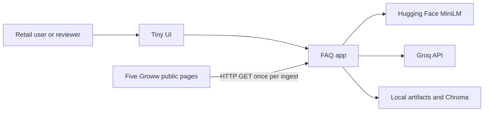
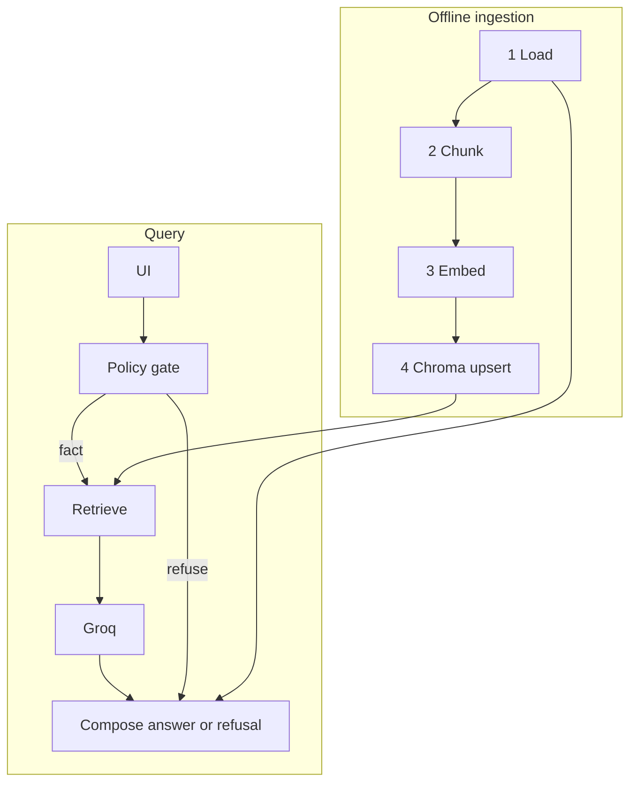
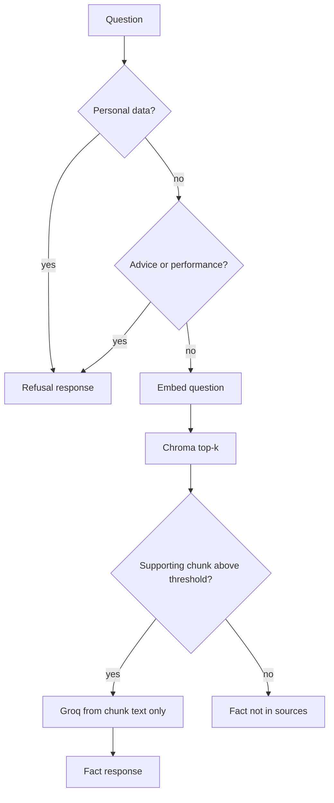

# Architecture

## Mutual Fund FAQ Assistant

This document describes how the prototype in `Doc/PRD.md` is built. It is a single-process RAG demo: an offline ingestion pipeline writes inspectable artifacts, and a tiny UI answers from those artifacts. Nothing here is a production service.

## 1. System context

| Actor | Talks to | Does not talk to |
| --- | --- | --- |
| User | UI only | Groww pages, Groq, Chroma, the filesystem |
| Ingestion | The five seed URLs, the embedding model, local disk, Chroma | Any URL linked from those pages, Groq |
| Query path | Embedding model, Chroma, Groq, the curated link list | The open web |

Groq is used only at answer time. Ingestion does not call an LLM.

## 2. Runtime shape

One Python process. Ingestion is a command the operator runs. The UI is a single page served by that same process after the index exists.

There is no account store, no query log that keeps the raw question, and no second vector database.

## 3. Components

| Component | Responsibility |
| --- | --- |
| Config | Reads embedding model, Chroma path, collection name, chunk limits, and top-k. Reads the Groq model ID and API key from the environment. |
| Loader | HTTP GET of the five seed URLs. Writes one raw artifact per page and a manifest with the fetch date. |
| Chunker | Turns each raw page into section-sized chunks. Fact labels stay inside one chunk when the page structure allows it. |
| Embedder | `sentence-transformers/all-MiniLM-L6-v2` for both chunks and questions. Writes an embedding artifact keyed by chunk ID. |
| Vector store | ChromaDB on a local path from config. One collection. Metadata on every record is what the citation is built from. |
| Policy gate | Runs before retrieval and before Groq. Classifies the question as fact, refusal, or personal-data. |
| Retriever | Embeds the question with the same model and queries the same collection. |
| Answer composer | Calls Groq only for an allowed factual question that has supporting chunks. Attaches one URL from chunk metadata and the manifest date. Refusals skip Groq. |
| UI | Welcome line, three example questions, disclaimer, input, and the response. |
| Link catalog | URLs that may be cited. Ingested pages plus educational links. Educational links are never fetched or embedded. |

## 4. Ingestion pipeline

Each phase reads the previous phase’s files and writes its own directory. Re-running a phase replaces that phase’s output. The manifest records the fetch date used in every answer.

### 4.1 Load

Input: the five URLs in the PRD corpus table.

For each URL:

1. GET the page. Do not parse or request `href` targets.
2. On a non-success status, stop and report that URL. Do not fill the gap from a blog, cache, or mirror.
3. Write `data/raw/<page_id>.json` with `url`, `page_id`, `title`, `scheme_name`, `http_status`, `fetched_at`, and `html`.
4. Write `data/manifest.json` with `fetched_on` (`YYYY-MM-DD`) and the list of page IDs.

`page_id` values are fixed: `amc`, `large_cap`, `flexi_cap`, `elss`, `mid_cap`.

### 4.2 Chunk

Input: `data/raw/*.json` only.

Strategy, chosen for these scheme pages:

1. Parse HTML and drop script, style, nav, and footer.
2. Split on headings and on labeled fact rows (expense ratio, exit load, minimum SIP, lock-in, riskometer, benchmark, and statement or download blocks).
3. Keep a labeled fact row whole. Do not cut inside it.
4. If a section is still longer than the configured maximum, split it on paragraph boundaries with the configured overlap. A fact row is never the unit that gets overlapped apart.
5. Give each chunk a stable ID: `<page_id>-<ordinal>`.

Write `data/chunks/<page_id>.json` as a list of `{chunk_id, page_id, url, title, scheme_name, text}`.

The maximum length and overlap live in the config file. Defaults belong in the README once measured against the saved HTML.

### 4.3 Embed

Input: the chunk files.

1. Load `sentence-transformers/all-MiniLM-L6-v2` using the model name from config.
2. Embed each chunk’s `text`.
3. Write `data/embeddings/<page_id>.json` with `chunk_id` and the vector, so this stage is visible without opening Chroma.

The vector width is whatever that model emits (384 for MiniLM-L6-v2). The app does not hard-code a second model.

### 4.4 Index

Input: chunk records plus their vectors.

Upsert into the Chroma collection named in config. The persisted directory is the Chroma path in config. Each record stores:

| Field | Use |
| --- | --- |
| `id` | `chunk_id` |
| `document` | chunk text |
| `embedding` | vector from phase 3 |
| `url` | citation target |
| `title` | page title |
| `scheme_name` | which scheme or the AMC page |
| `page_id` | join back to raw and chunk files |

Chroma is the only index the retriever queries. The JSON files exist so a reviewer can open load, chunk, and embed without a database client.

## 5. Query path

### 5.1 Policy gate

The gate is deterministic and runs first. Groq is not asked to decide whether the question is allowed.

| Class | Examples | Next step |
| --- | --- | --- |
| Personal data | PAN, Aadhaar, account number, OTP, email, phone | Refusal. Do not write the question to disk. Do not send it to Groq. Do not echo the value. |
| Advice or comparison | buy, sell, should I, which is better, portfolio | Refusal. No retrieval required. |
| Performance | returns, CAGR, alpha, “which performed better” | Refusal that points at the official factsheet. No calculation. |
| Fact | expense ratio, exit load, SIP, lock-in, riskometer, benchmark, statement download, other lookups | Retrieve, then maybe Groq. |

A question that mixes a fact with advice is treated as advice.

### 5.2 Retrieval

1. Embed the question with the config embedding model. This must be the same name used in phase 3.
2. Query the config collection for `top_k` neighbors.
3. Keep a hit only if its distance is within the configured threshold. Otherwise the fact is treated as absent.
4. Pass chunk text to the model. Pass URLs only to the composer, not as something the model may invent.

### 5.3 Generation

Groq is called only when the gate says fact and at least one chunk survives the threshold.

The prompt tells the model to:

- use only the supplied chunk text
- answer the single fact asked
- stay within three sentences
- say the fact is not in the supplied text when it is not
- give no advice and no performance comparison

The model returns sentences only. It does not choose the URL.

### 5.4 Composer

The composer builds the payload the UI shows.

**Fact.** Model sentences, then exactly one link: the `url` metadata of the highest-ranked surviving chunk whose text supports the answer. Then `Last updated from sources: <fetched_on from manifest>`.

**Fact absent.** A short statement that this corpus does not contain that fact, one link to the most relevant in-scope page if a scheme was named, otherwise the AMC page, and the same last-updated line. No Groq call is required for this branch.

**Refusal.** A fixed polite template: facts only, no investment advice, no performance comparison. Exactly one link from the link catalog:

| Refusal | Link |
| --- | --- |
| Personal data | AMC overview page |
| Buy, sell, or which-is-better | AMC overview page, or the named scheme page if one of the four schemes is named |
| Returns or performance | Official factsheet URL for the named scheme, from the catalog, not from a crawl |

Refusals do not include numbers from the index.

## 6. UI

One page.

| Region | Content |
| --- | --- |
| Welcome | Names the assistant and Aditya Birla Sun Life as the only AMC in scope. |
| Examples | Three buttons that submit a factual question, for example expense ratio, ELSS lock-in, and minimum SIP. |
| Disclaimer | Visible at all times: `Facts-only. No investment advice.` |
| Composer | Text field and submit. |
| Response | Answer or refusal, one link, last-updated line. |

The page does not show chunk debug data. Reviewers inspect `data/` for the pipeline. The UI does not keep a transcript on the server.

## 7. Configuration and secrets

| Item | Where | Notes |
| --- | --- | --- |
| Embedding model | Config file | Default `sentence-transformers/all-MiniLM-L6-v2` |
| Chroma path and collection | Config file | Local directory |
| Chunk maximum, overlap, top-k, distance threshold | Config file | Documented in the README |
| Five ingest URLs and page IDs | Config or checked-in catalog | Loader will not accept extra URLs |
| Educational and factsheet URLs | Link catalog | Not ingested |
| `GROQ_MODEL` | `.env` | Brief names `qwen/qwen3.8-27b`; the value in `.env` wins |
| `GROQ_API_KEY` | `.env` | Never written to source, logs, docs, or sample Q&A |

`.env.example` lists the variable names and leaves the key blank.

Changing the embedding model or the Chroma settings in config retargets ingestion and retrieval together. Query code does not instantiate a different model or a different collection from the ones in that file.

## 8. Link catalog

Two roles, one file:

| Role | Fetched | Embedded | Used as |
| --- | --- | --- | --- |
| `ingest` | Yes | Yes | Citation for facts found on that page |
| `reference` | No | No | Refusal and factsheet links only |

The submission source list of 15–25 URLs is this catalog: 5 ingest rows plus reference rows. Reference rows are not passed to the loader.

## 9. Data the system stores

| Path | Contents | Contains questions or PII |
| --- | --- | --- |
| `data/raw/` | Page HTML and fetch metadata | No |
| `data/chunks/` | Chunk text and source metadata | No |
| `data/embeddings/` | Vectors by chunk ID | No |
| `data/chroma/` | Chroma collection | No |
| `data/manifest.json` | Fetch date and page IDs | No |

User questions are held in memory for the request and then dropped. A refusal triggered by personal data drops the text before any model call.

## 10. Failure behavior

| Condition | Behavior |
| --- | --- |
| A seed URL fails during load | Ingestion stops with that URL and status. The index is not silently filled from another site. |
| Chroma directory missing at query time | UI reports that ingestion has not been run. |
| Groq error or timeout | UI reports that an answer could not be generated. It does not invent the fact. |
| Model names a URL | Ignored. The composer uses metadata. |
| Embedding model in config differs from the vectors already stored | Query refuses to run until ingestion is repeated with the current config. The manifest stores the model name used at embed time so this check is explicit. |

## 11. Mapping to the PRD

| PRD item | Where it lives |
| --- | --- |
| Five pages only | Loader input plus catalog role `ingest` |
| Inspectable stages | `data/raw`, `data/chunks`, `data/embeddings`, Chroma |
| One citation | Composer, from chunk metadata |
| Three sentences and last-updated line | Prompt plus composer |
| Refuse advice and returns | Policy gate, before Groq |
| No PII storage | Gate drops the question; no query log |
| Config-swappable embedder and Chroma | Config file, shared by ingest and query |
| Groq model and key | `.env` only |
